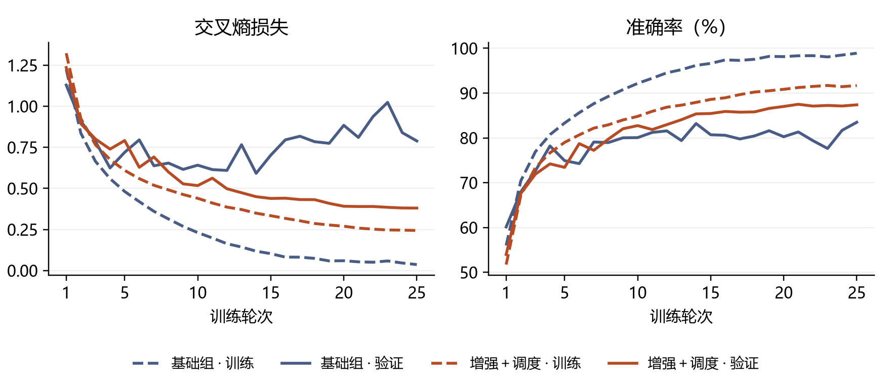

# CIFAR-10 图像分类实验

同一个卷积网络，改训练方法能差多少？我在 CIFAR-10 上比较了四种组合：是否做数据增强，以及学习率保持不变还是逐轮降低。四组用了同一份训练集和验证集，各训练 25 轮。增强加余弦调度组在第 21 轮得到最高验证准确率 **87.50%**。选用这一轮的权重，在官方测试集的 10,000 张图片中认对了 **8,642 张，准确率为 86.42%**。

## 直接复核测试成绩

仓库附有[最终权重](runs/augment_cosine_seed42/best.pt)和[训练配置](runs/augment_cosine_seed42/config.json)，可以直接评估。下列命令适用于 Windows PowerShell。本次运行使用 Python 3.12.10、PyTorch 2.6.0、CUDA 12.4 和 RTX 4060 Laptop GPU。

```powershell
git clone https://github.com/sakannnna/cifar10-cnn-classification.git
cd cifar10-cnn-classification
py -3.12 -m venv .venv
.\.venv\Scripts\python.exe -m pip install -r requirements.txt
.\.venv\Scripts\python.exe evaluate_test.py --download --out verification/test
```

第一次运行会把 CIFAR-10 下载到 `data/` 并校验文件。已有官方压缩包时，也可以把 `cifar-10-python.tar.gz` 放进该目录，程序会校验并解压。预期输出为 `Epoch 21 | correct 8642/10000 | accuracy 86.42%`。有 CPU 版 PyTorch 的环境可加 `--device cpu` 运行。新预测保存在 `verification/test/`，便于与[原始预测](results/seed42/test/predictions.csv)逐张核对。

## 四组训练结果

CIFAR-10 有十类 32×32 彩色图像。官方训练集每类 5,000 张，其中 4,500 张用于训练、500 张用于验证；10,000 张官方测试图像单独评估。网络用三组卷积逐步提取特征，通道数从 32 增至 64、128，再经过全局平均池化和线性层给出十个类别的分数。每组从头训练，使用种子 42、Adam、交叉熵损失和大小为 128 的批次，按验证准确率选择权重。

| 训练方法 | 最佳验证准确率 | 最佳轮次 | 第 25 轮验证准确率 | 训练记录 |
| --- | ---: | ---: | ---: | --- |
| 基础 CNN | 83.48% | 25 | 83.48% | [CSV](runs/baseline_seed42/history.csv) |
| 仅余弦调度 | 85.38% | 24 | 85.22% | [CSV](runs/cosine_seed42/history.csv) |
| 仅数据增强 | 86.06% | 25 | 86.06% | [CSV](runs/augment_seed42/history.csv) |
| 数据增强＋余弦调度 | **87.50%** | **21** | 87.38% | [CSV](runs/augment_cosine_seed42/history.csv) |

增强组在训练时先补 4 像素黑边，随机裁回原尺寸，再以 50% 的概率水平翻转。固定学习率组全程使用 0.001，余弦调度组从 0.001 逐轮降至 0.00001。四组验证时都只将像素值缩放到 [−1, 1]。单用增强比基础组高 2.58 个百分点，同时使用增强和调度高 4.02 个百分点；这是种子 42 下的结果。



## 哪里容易分错

每类各有 1,000 张测试图像。汽车识别得最好（94.7%），猫最低（69.4%）。其中 120 张猫被判为狗，86 张狗被判为猫，两种情况合计占全部错误的 15.2%。在错例图中可以按编号找回测试原图；CAM 图用同一色标比较一张图的不同区域对“猫”和“狗”两个分数的贡献。

[每类准确率](results/seed42/test/per_class.csv) · [混淆矩阵](results/seed42/test/confusion_matrix.png) · [六张错例](results/seed42/test/typical_errors.png) · [猫狗 CAM 对照](results/seed42/test/cat_dog_cam.png)

## 重新训练或绘图

`runs/` 保存四组的原始配置、划分索引和逐轮记录。以下命令将新训练放到 `retrain/`。输出目录需要是新目录，以免覆盖已有结果。

```powershell
$py = ".\.venv\Scripts\python.exe"
$split = "runs/baseline_seed42/split.npz"
& $py train.py --split $split --out retrain/baseline_seed42
& $py train.py --split $split --scheduler cosine --out retrain/cosine_seed42
& $py train.py --split $split --augment --out retrain/augment_seed42
& $py train.py --split $split --augment --scheduler cosine --out retrain/augment_cosine_seed42
& $py compare_runs.py --runs retrain --out verification/retrained
```

只想重画图时可以使用已保存的记录。下面第一条生成基础组与最终组的训练、验证曲线；第二条比较四组验证结果。最后两条使用上面复核得到的预测目录，分别绘制混淆矩阵与典型错例、猫狗类别激活图。

```powershell
$py = ".\.venv\Scripts\python.exe"
& $py plot_learning.py
& $py compare_runs.py
& $py plot_test.py verification/test
& $py cat_dog_cam.py --result verification/test
```
